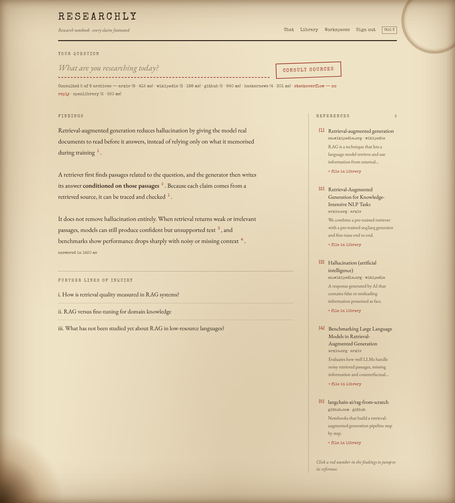
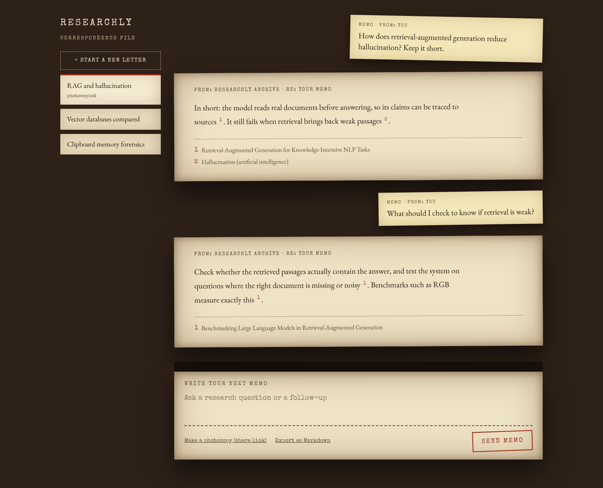
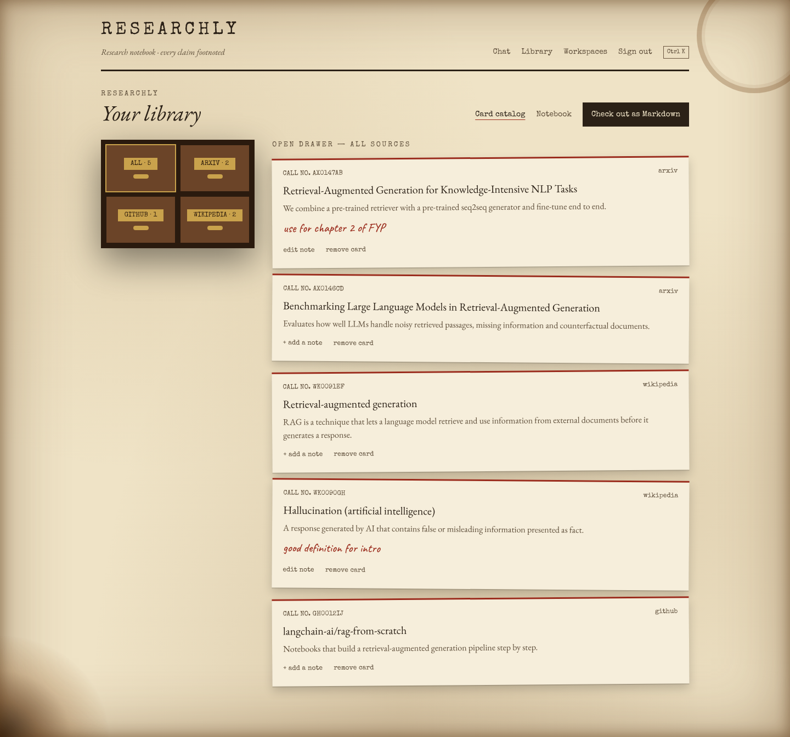
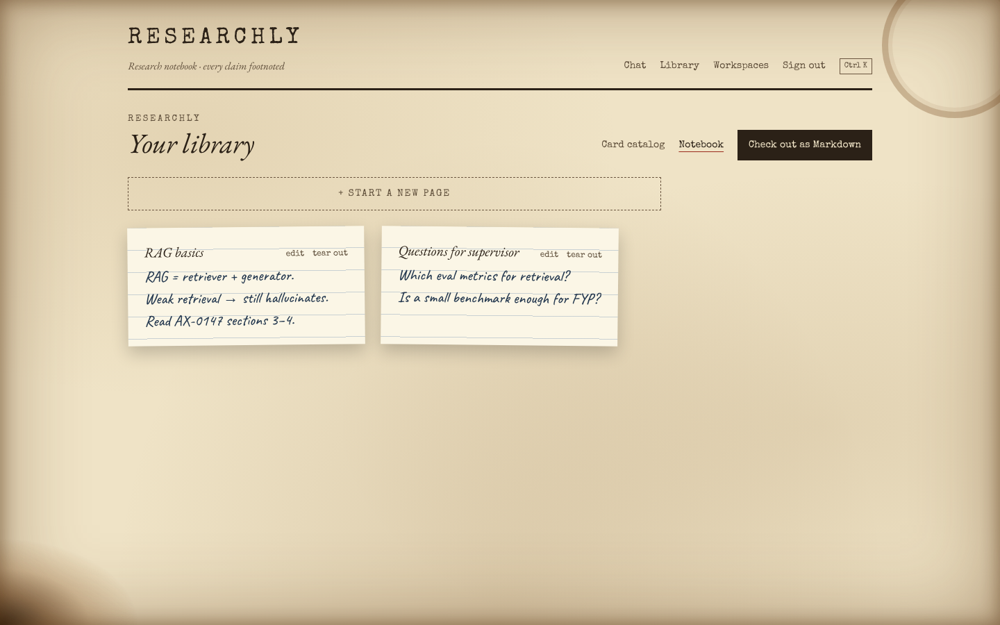
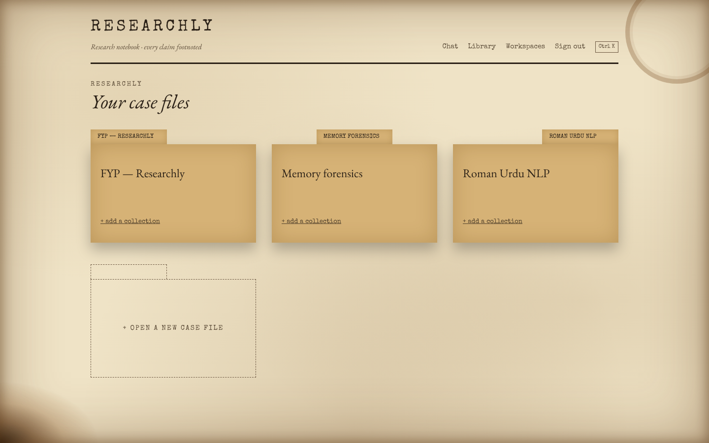
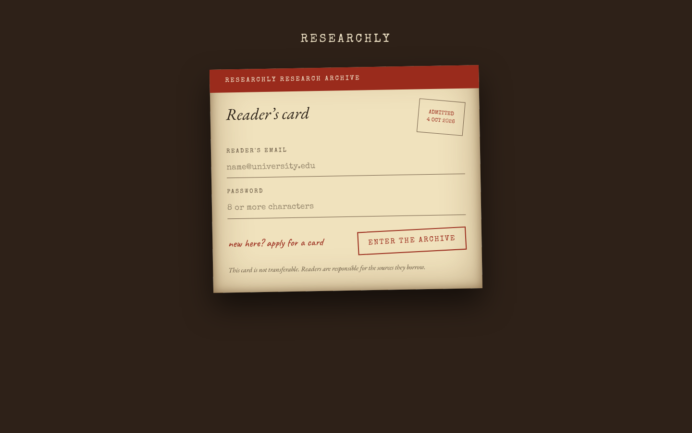
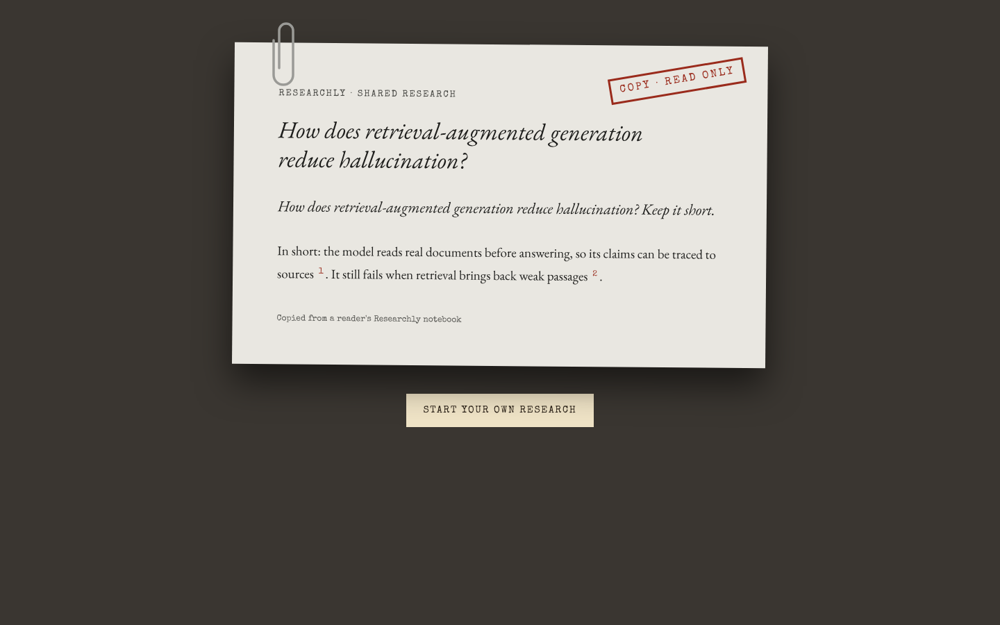
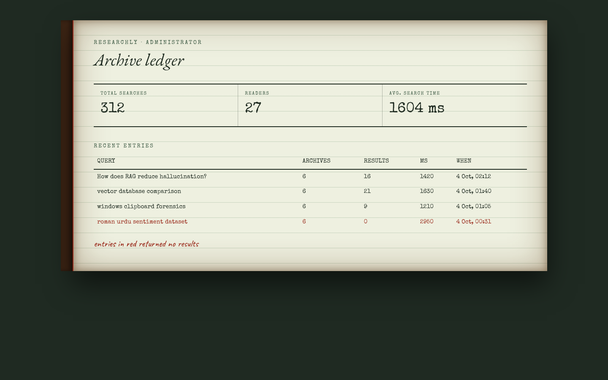
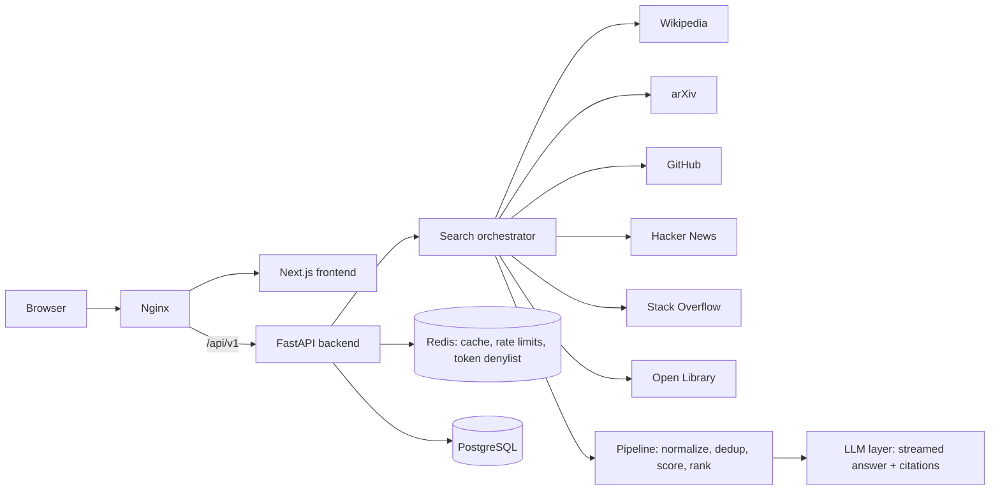

# Researchly

Research answers you can trace back to the source.

An AI research platform. You ask one question, Researchly searches several sources in parallel, cleans and ranks the results, and streams back an answer with numbered citations linked to the original sources.

**Stack:** Next.js · TypeScript · FastAPI · PostgreSQL · Redis · Docker · Nginx



| | |
|---|---|
|  |  |
|  |  |
|  |  |
|  |  |

<sub>Screenshots show the real interface filled with sample data.</sub>

---

## What it does

- **Parallel multi-source search**: Wikipedia, Hacker News, arXiv, GitHub, Stack Overflow and Open Library are queried at the same time. A slow or failing source is timed out and skipped instead of breaking the whole search.
- **Result pipeline**: normalize → deduplicate → score → rank.
- **Streaming cited answers**: the answer streams in over SSE, and every `[n]` links to its source.
- **Research chat**: multi-turn conversations that keep context and citations, shareable through public links.
- **Workspace tools**: bookmarks with notes, collections, a notebook, and Markdown export.
- **Old research paper interface**: every page is a physical research object. Search results read like a footnoted paper, the library is a card catalog, chat is written correspondence, workspaces are case files.
- **Pluggable LLM layer**: works with Anthropic or Grok (xAI). With no API key it still returns an extractive answer built from the top sources, with citations.

## Architecture



## Security and reliability

- JWT access + refresh tokens, with refresh-token rotation and revocation (jti denylist in Redis)
- bcrypt password hashing, role-based access control, `/logout` endpoint
- Rate limiting and caching (Redis, with an in-memory fallback)
- Nginx security headers, SSE buffering disabled for streaming
- Structured logging, health checks, GitHub Actions CI

## Run it

### With Docker (recommended)

```bash
cp .env.example .env      # then fill in the values
docker compose up --build
```

Open **http://localhost:8080**. This starts PostgreSQL, Redis, the API, the frontend and Nginx.

### Without Docker

Backend (uses SQLite and in-memory cache automatically):

```bash
cd backend
python -m venv .venv
.venv\Scripts\activate          # Windows  (macOS/Linux: source .venv/bin/activate)
pip install -r requirements.txt
uvicorn app.main:app --reload   # API docs at http://localhost:8000/docs
```

Frontend:

```bash
cd frontend
npm install
npm run dev                     # http://localhost:3000
```

### Choosing an LLM

Set these in `.env`:

| Provider | Settings |
|---|---|
| Anthropic | `NEXUS_ANTHROPIC_API_KEY=...` |
| Grok (xAI) | `NEXUS_LLM_PROVIDER=grok`, `NEXUS_LLM_MODEL=...`, `NEXUS_GROK_API_KEY=...` |
| None | Leave keys empty and you get extractive cited answers |

## Adding a search provider

Providers are plugins. Create `backend/app/providers/yourprovider.py`:

```python
@register_provider
class YourProvider(SearchProvider):
    name = "yourprovider"
    description = "..."
    async def search(self, query, client, limit): ...
```

Then import it in `app/providers/__init__.py`. The orchestrator, API and UI pick it up automatically.

## Tests

```bash
cd backend
python -m pytest tests
```

The tests cover the result pipeline (normalization, dedup, scoring, ranking), the orchestrator's guarantees (parallel calls, per-provider timeouts, failure isolation), and the full auth and bookmarks API flow.

## Status

**Working:** everything listed above.

**Needs an API key:** synthesized LLM answers and follow-up question suggestions. Semantic embedding rerank needs an OpenAI key; without it Researchly uses the lexical ranker.

The environment variables keep the `NEXUS_` prefix from the project's original name.

**Not built yet:** end-to-end and accessibility tests, PDF export (Markdown only), an admin UI to enable or disable providers, analytics charts.

## License

MIT
